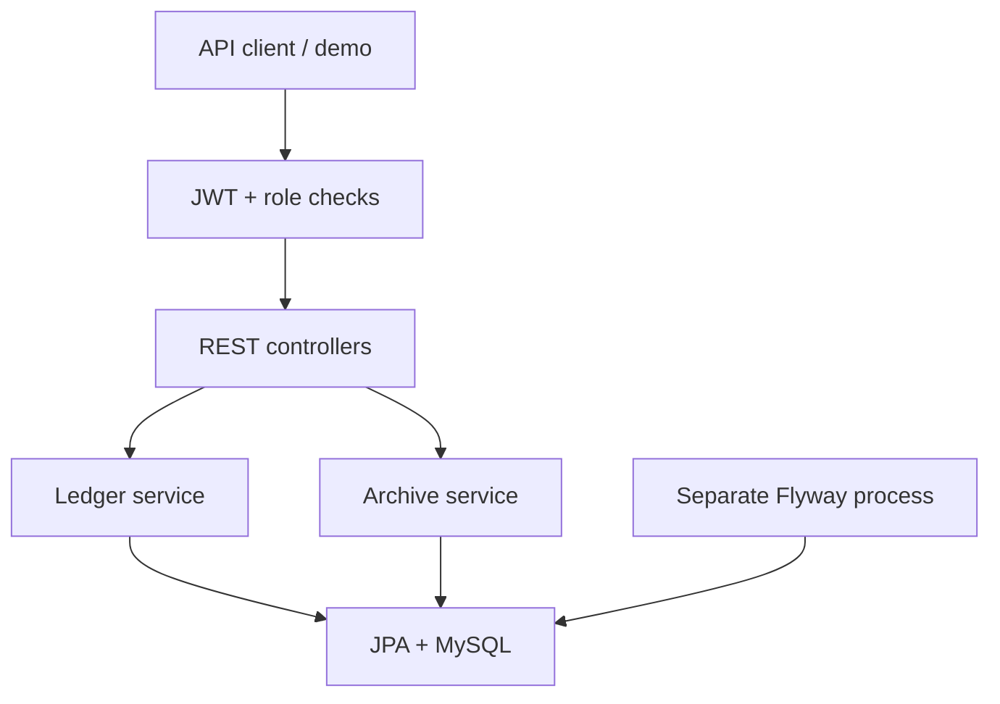

# LedgerVault — a financial ledger that preserves its history

A Java 17 / Spring Boot backend for small-business customer ledgers. Owners manage shops and staff; staff record invoices and payments; corrections append linked records instead of overwriting history.

**Demonstrates:** tenant authorization, immutable financial records, transaction isolation, row locking, database migrations, restricted database privileges, and integration testing on real MySQL.

| Stack | Choice |
| --- | --- |
| Application | Java 17, Spring Boot, Spring Security, JPA |
| Persistence | MySQL 8.4.13, Flyway |
| Authentication | Versioned JWT with immutable user IDs; BCrypt passwords |
| Verification | JUnit, MockMvc, H2, Testcontainers/MySQL |
| Delivery | Docker Compose; GitHub Actions configuration |

## Try the two-minute demo

With Docker Compose v2 and Python 3.9+:

```bash
python scripts/init_env.py
docker compose up --build --wait
python scripts/demo.py
```

The setup generates local secrets, migrates MySQL, and starts the API on `http://localhost:8080`. The walkthrough creates synthetic records, checks real HTTP responses, and prints the results without exposing credentials. See [demo instructions](docs/DEMO.md), [executed output](docs/demo-output.txt), [sample requests](docs/requests.http), and [Swagger UI](http://localhost:8080/swagger-ui/index.html).

## What makes the ledger reliable

- **Append-only corrections:** the original stays unchanged; a correction appends a linked reversal and replacement with actor, time, and reason. A replacement can be corrected again, preserving the chain.
- **History-preserving archival:** staff/customer/shop removal becomes archival. Financial records remain readable. Archived staff cannot sign in or use existing tokens.
- **Concurrency control:** writers share-lock the shop, exclusively lock the customer, and validate the resulting balance inside a READ_COMMITTED transaction. Simultaneous payments cannot both spend the same outstanding balance.
- **Database safeguards:** restrictive foreign keys prevent cascading financial deletion; MySQL triggers reject ledger UPDATE/DELETE; unique references prohibit duplicate reversals.
- **Separated privileges:** a one-shot migration process owns schema changes; the API database account cannot alter schema or remove protection triggers.
- **Tenant isolation:** owners access their shops; staff access their assigned shop. Administrative provisioning does not grant automatic access to customer ledgers.



The [architecture notes](docs/ARCHITECTURE.md) explain lock ordering, correction math, permissions, and limits.

## A correction you can explain in an interview

An invoice of 100 and a payment of 40 produce a balance of 60. Correcting the invoice to 120 appends a CREDIT reversal of 100 and a DEBIT replacement of 120. All four records remain; the resulting outstanding balance is 80.

```json
{
  "replacement": {
    "entryType": "DEBIT",
    "amount": 120.00,
    "description": "Corrected invoice 001"
  },
  "reason": "Missing item found during receipt review"
}
```

Send this to `POST /api/customers/ledger-entries/{entryId}/corrections` as an OWNER or MANAGER. Response fields link the reversal and replacement to the original. Ledger PUT/DELETE and legacy parent-delete endpoints return HTTP 405, guiding clients to corrections, reversals, and archival.

## Verify it

With a full JDK 17+:

```bash
./mvnw clean verify
```

With Docker running, include real MySQL tests:

```bash
./mvnw -Pmysql-it clean verify
```

Windows: replace `./mvnw` with `.\mvnw.cmd`. Testcontainers creates disposable MySQL instances; the integration suite fails if it cannot obtain a real database. An explicitly supplied disposable MySQL instance is also supported.

The supplied validation record reports **41 fast tests and 31 MySQL integration test executions**. The MySQL checks include a populated V1→V2 upgrade, SQL-level deletion/update rejection, actual lock waiting, simultaneous payment/correction requests, and rollback when the replacement insert fails. The same API contract runs against both databases; these counts are test executions, not 72 distinct scenarios.

See [verification evidence](VALIDATION.md) and [migration/test setup](docs/MIGRATIONS.md). GitHub Actions is configured to run the full suite on pushes and pull requests; hosted CI has not yet been verified for this repository.

## Configuration and operation

Docker Compose reads the generated `.env`. A plain Spring Boot process does not automatically read it; configure process environment variables when running outside Docker:

| Variable | Purpose |
| --- | --- |
| `DB_URL`, `DB_USERNAME`, `DB_PASSWORD` | Application database connection |
| `JWT_SECRET` | Base64 encoding of at least 32 random bytes; no default key |
| `JWT_EXPIRATION_MS` | Optional token lifetime; default one hour, maximum one day |
| `CORS_ALLOWED_ORIGINS` | Comma-separated exact browser origins; empty denies cross-origin requests |
| `BOOTSTRAP_ADMIN_ENABLED` | Explicit first-time admin setup; otherwise false |
| `BOOTSTRAP_ADMIN_USERNAME`, `BOOTSTRAP_ADMIN_EMAIL`, `BOOTSTRAP_ADMIN_PASSWORD` | Bootstrap identity; password at least 12 characters and at most 72 UTF-8 bytes |
| `SPRING_FLYWAY_ENABLED` | False for restricted runtime accounts after the separate migration process |

Disable admin bootstrap after initial setup. Preserve your local secrets while retaining the database volume. The Docker setup uses a persistent volume and binds the API to loopback; `docker compose down` stops services without deleting data. Local demo transport uses HTTP and database TLS is disabled only on the internal Compose network; configure appropriate transport security for deployment.

## Scope and remaining work

This is a customer-balance ledger, not double-entry accounting. DEBIT increases the amount owed; CREDIT records a payment. Prepayments/negative balances are disallowed. Reported debit/credit totals include reversal postings. Archival freezes new changes but does not settle debt; there is no restore endpoint yet.

Next improvements: idempotency keys for repeated ledger-create requests, pagination, login throttling/password-reset workflows, framework/dependency modernization, and backup/restore drills. Spring Boot remains on the original 3.2.5 line; the dependency stack needs a supported-version upgrade and security review before production deployment. The current Flyway version warns that its upstream-tested MySQL support ends at 8.0; the supplied 8.4.13 migration and API test record does not replace that upstream support guarantee.

[CHANGELOG.md](CHANGELOG.md) records the implementation; [REVIEW.md](REVIEW.md) summarizes the assessment; [SOURCE.md](SOURCE.md) records the supplied project's provenance. The Java package namespace remains `com.khatavision.backend` for compatibility; the product, repository, database and artifact branding is LedgerVault.
