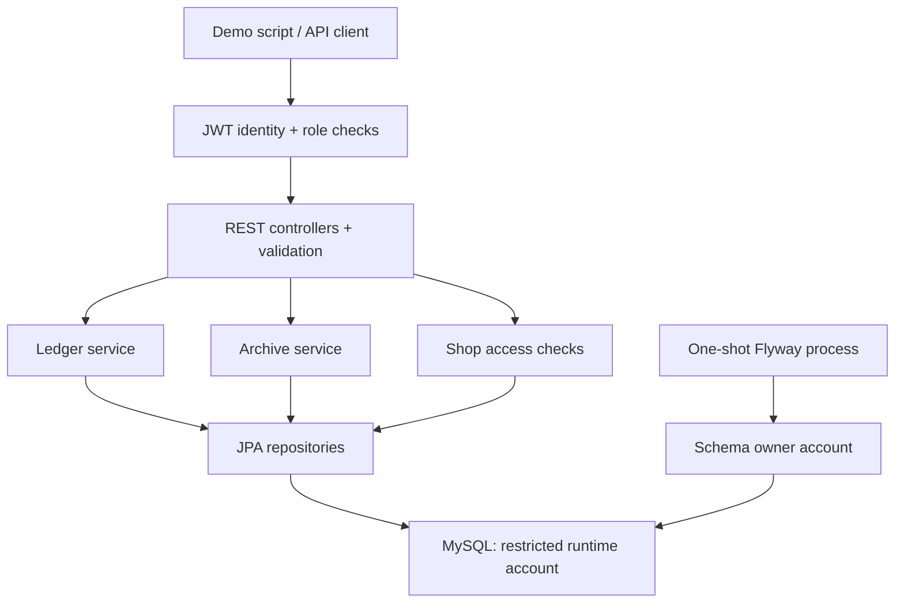

# LedgerVault architecture and guarantees

The application remains one modular backend. JWTs contain an immutable user ID and token version; the current account and roles are reloaded for each request. Archived staff are rejected both at password login and bearer-token authentication. Controllers enforce roles and services enforce shop ownership/assignment.

## Append-only corrections

For an original invoice of 100 and a payment of 40, correcting the invoice to 120 produces:

| Record | Type | Amount | Reference | Net contribution |
| --- | --- | ---: | --- | ---: |
| Original invoice | ORIGINAL / DEBIT | 100 | — | +100 |
| Payment | ORIGINAL / CREDIT | 40 | — | -40 |
| Reversal | REVERSAL / CREDIT | 100 | `reversesEntryId` → original invoice | -100 |
| Corrected invoice | REPLACEMENT / DEBIT | 120 | `replacesEntryId` → original invoice | +120 |

Net outstanding is **80**. Every correction records its actor, timestamp, and reason. The original is never overwritten. A unique reversal reference prevents reversing the same entry twice. A replacement can itself be corrected, forming an explicit chain; a reversal cannot be corrected or reversed. `totalDebit` and `totalCredit` are gross posted totals, including reversals; net balance is their difference.

MySQL triggers reject UPDATE and DELETE on ledger entries. Foreign keys restrict deletion of ledger customers, recorders, customer shops, and shop owners. The runtime account has SELECT/INSERT/UPDATE/DELETE only; schema creation and trigger installation happen in a separate process. This protects against accidental application/database writes, not a database administrator capable of dropping constraints or triggers.

## Transaction and locking model

Ledger writers take a shared lock on the shop and an exclusive lock on the customer, then read the aggregate balance and append rows in one transaction. Different customers in a shop can proceed concurrently; writes to the same customer serialize. Shop archival takes an exclusive shop lock. Customer archival takes locks in the same shop-then-customer order.

The isolation level is READ_COMMITTED for ledger and archival transactions. This ensures a balance query performed after waiting for a customer lock sees a newly committed payment rather than a snapshot established before the wait. A correction validates `current balance - original contribution + replacement contribution` before adding its two records. If the second insert fails, the reversal rolls back too.

Staff archival disables future authentication. An already authorized in-flight request can finish; this implementation does not cancel requests that are already running.

## Archival

Staff, customers, and shops retain `archivedAt`, `archivedByUserId`, and `archiveReason`. Repeating archival retains the original metadata. Archived customers and shops remain readable to authorized users and cannot accept new ledger entries or corrections. Archival does not settle an outstanding balance, erase a staff assignment, or imply payment. There is no restore endpoint yet; finish corrections before archival.

Legacy hard-delete endpoints and direct ledger PUT/DELETE return HTTP 405. Corrections/reversals require OWNER or MANAGER; DATA_ENTRY can create entries but cannot rewrite history. VIEWER is read-only. ADMIN provisions owners and does not automatically receive access to customer ledgers.

## Known limits

No ledger-create idempotency key, pagination, multi-currency model, password-reset workflow, or immutable audit of nonfinancial metadata edits is included. This is a single-customer balance ledger, not a double-entry general accounting system. The framework dependency line still needs modernization and a dependency security review before production deployment. Backups and restore drills remain operational requirements.
